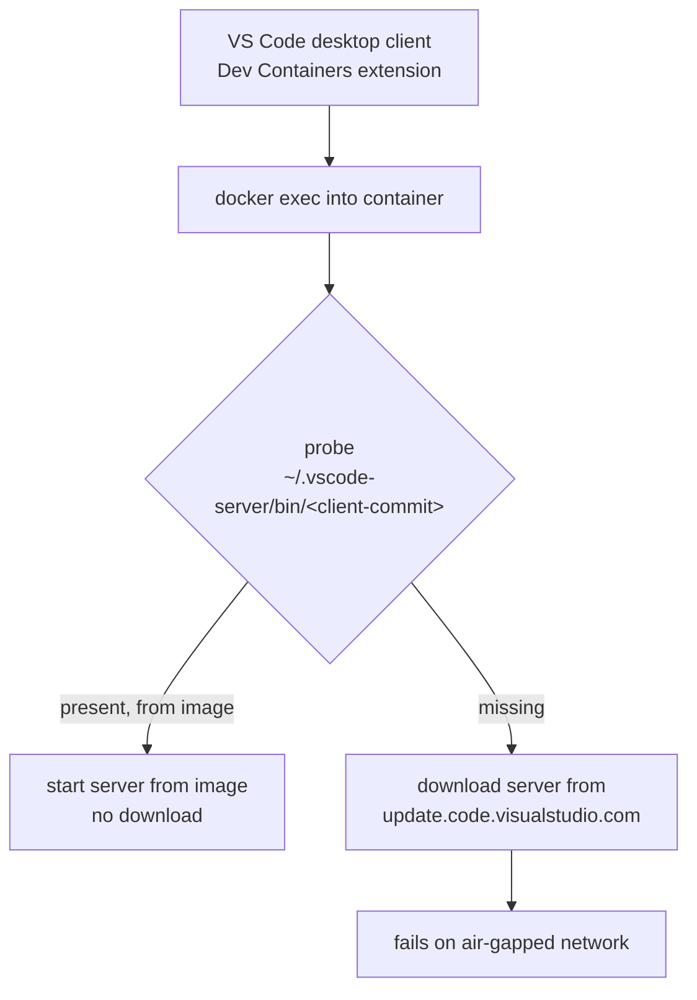

# agent-ide - air-gapped VS Code dev containers

Base images for Docker containers that behave as turnkey VS Code Dev
Containers **on air-gapped networks**: the VS Code Server is baked into the
image at build time, so attaching from a VS Code desktop client never has to
download `vscode-server` from `update.code.visualstudio.com` inside the
isolated network.

The first image in this repo is `Dockerfile` (Rocky Linux 9 base). Feature
images built on top of it (AI agents, sandbox policy, toolchains) are expected
to use this as their `FROM`.

## Why pre-install the server

When VS Code (Dev Containers / Remote extensions) attaches to a container, it
checks for a server matching its own **commit** at
`~/.vscode-server/bin/<commit>/`. If it is not there, it downloads it (or
transfers a copy from the client) - which fails on air-gapped networks. Baking
the server plus the same install marker the tooling itself writes makes the
client reuse it and start with zero network access.



The consequence: **the commit baked into the image must match the commit of the
desktop clients** that attach to it (image default: VS Code 1.142.0).

## Repository layout

| Path | Purpose |
| --- | --- |
| `Dockerfile` | Rocky 9 base image with the VS Code Server baked in |
| `scripts/install-vscode-server.sh` | Build-time server + CLI installer (download, verify, layout, smoke test) |
| `scripts/install-extensions.sh` | Build-time `.vsix` installer |
| `scripts/vscode-web.sh` | Runtime helper: serve the browser UI offline (`vscode-web`) |
| `vsix/` | Drop `.vsix` extension packages here before building |
| `examples/.devcontainer/` | Example `devcontainer.json` for consumers of the image |
| `testing/` | Air-gap acceptance test on a disconnected KVM VM (`testing/README.md`), bundle builder + in-VM test script |

## Build

Requires BuildKit (default in Docker 23+ and Podman 4+; the VSIX step uses
`RUN --mount` so extension payloads never enter the image).

```sh
docker build -t agent-ide-base:rocky9 .
```

### Build arguments

| Argument | Default | Meaning |
| --- | --- | --- |
| `VSCODE_COMMIT` | `6d62b1d5dace93a33b3a6d3eca1317bd5e15bcb1` (1.142.0) | Commit of the desktop release to match. **Must match your client fleet.** |
| `VSCODE_ARCH` | `x64` | `x64` or `arm64` |
| `VSCODE_SERVER_SHA256` | sha256 of the 1.142.0 x64 tarball | Verification checksum; set to `""` to skip |
| `VSCODE_SERVER_URL` | update.code.visualstudio.com | Full URL override (internal mirror) |
| `VSCODE_CLI_URL` | code.visualstudio.com downloads | Full URL override for the CLI tarball |
| `INSTALL_VSCODE_CLI` | `true` | Install standalone `code` CLI (tunnel/serve-web on connected networks) |
| `VSCODE_WEB_SERVER_SHA256` | sha256 of the 1.142.0 x64 web tarball | Checksum for the browser-UI server build; `""` skips |
| `VSCODE_WEB_SERVER_URL` | update.code.visualstudio.com | Full URL override for the web server tarball |
| `INSTALL_WEB_SERVER` | `true` | Bake the browser-UI server (largest optional component; set `false` to slim the image) |
| `USERNAME` / `USER_UID` / `USER_GID` | `vscode` / `1000` / `1000` | Dev-container user (devcontainer convention, passwordless sudo) |

### Matching your fleet's commit

- In VS Code desktop: **Help > About**, copy the `Commit:` hash.
- Or resolve current stable metadata:

  ```sh
  curl -s https://update.code.visualstudio.com/api/update/server-linux-x64/stable/latest | jq '{productVersion, version, sha256hash}'
  ```

  `version` is the commit for `--build-arg VSCODE_COMMIT`, `sha256hash` for
  `--build-arg VSCODE_SERVER_SHA256`.

```sh
docker build \
  --build-arg VSCODE_COMMIT=<fleet-commit> \
  --build-arg VSCODE_SERVER_SHA256=<sha256> \
  -t agent-ide-base:rocky9 .
```

The build fails loudly on checksum mismatch or an unexpected server layout
rather than shipping a silently broken image.

## What lands in the image

```
/home/vscode/.vscode-server/
|-- bin/<commit>/
|   |-- 0                      install marker -> client skips download
|   |-- bin/code-server        launcher (node out/server-main.js)
|   `-- node, out/, extensions/  server runtime + built-in extensions
|-- extensions/                user extensions (from ./vsix)
`-- data/Machine/settings.json workspace trust, telemetry, update checks disabled

/opt/vscode-server-web/bin/<commit>/   browser-UI server (web workbench assets)
```

Machine-scope settings baked in:

```json
{
  "security.workspace.trust.enabled": false,
  "telemetry.telemetryLevel": "off",
  "update.mode": "none",
  "extensions.autoCheckUpdates": false,
  "extensions.autoUpdate": false
}
```

These suppress first-run prompts and background traffic that would otherwise
just time out inside the sandbox. Adjust `scripts/install-vscode-server.sh` if
your policy needs trust prompts (and thus an interactive "trust this folder"
click per workspace).

## Using the image

### Attach from VS Code desktop (air-gapped path)

On the Docker host inside the isolated network:

```sh
docker run -d --name devbox agent-ide-base:rocky9 sleep infinity
```

Then in VS Code desktop: **Dev Containers: Attach to Running Container...** and
pick `devbox`. The client finds the pre-installed server and starts it over
`docker exec` - no download involved. (The Dev Containers **extension itself**
lives on the client machine and still comes from the marketplace; that is
outside the container.)

For a project devcontainer, copy the example and adjust:

```sh
cp -r examples/.devcontainer /path/to/project/
```

`examples/.devcontainer/devcontainer.json` uses `"image"` + `"remoteUser":
"vscode"`. Remote-side `extensions` entries would require marketplace access -
on air-gapped networks rely on the baked-in VSIX extensions instead.

### Browser UI, offline

```sh
docker run --rm -p 8000:8000 agent-ide-base:rocky9 vscode-web
# -> http://localhost:8000/
```

The regular server tarball does not contain the browser workbench assets, so
the image includes the separate web flavor of the server under
`/opt/vscode-server-web` (build arg `INSTALL_WEB_SERVER`, default `true`;
disable it to slim the image if you only ever attach from desktop VS Code).
`vscode-web` execs that server directly - it never triggers `code serve-web`'s
first-run asset download. Because it uses the same `~/.vscode-server` data
folder, extensions staged in `vsix/` show up in the browser UI as well.

By default it runs without a connection token - intended for trusted
networks; set `VSCODE_WEB_TOKEN=...` to require one, or use
`VSCODE_WEB_HOST=127.0.0.1` with `-p 127.0.0.1:8000:8000`.

### Extensions

Put `.vsix` files in `vsix/` and rebuild - see `vsix/README.md`. Installed
extensions are visible via the server's own CLI:

```sh
docker run --rm agent-ide-base:rocky9 \
  ~/.vscode-server/bin/*/bin/code-server --list-extensions --show-versions
```

## Air-gap checklist

1. Build (and rebuild for each VS Code release your clients run) on a connected
   host; keep the `VSCODE_COMMIT` in lockstep with your client rollout.
2. Stage all needed VSIX files in `vsix/` before building.
3. Transfer with `docker save agent-ide-base:rocky9 | gzip > image.tar.gz`
   and `docker load` inside the isolated network.
4. Verify inside the isolated network:
   `docker run --rm agent-ide-base:rocky9 bash -lc 'ls ~/.vscode-server/bin/*/0 && code --version'`
   and optionally `docker run --rm -p 8000:8000 agent-ide-base:rocky9 vscode-web`
   for the browser UI.
5. Note that `code tunnel`, `code serve-web` and settings sync all require
   Microsoft services and will not work fully isolated; the supported offline
   paths are desktop attach and `vscode-web`.
6. Run the end-to-end acceptance test on a disconnected KVM VM - see
   `testing/README.md` (bundle builder, in-VM test script, virsh commands).

## Notes and caveats

- **glibc**: VS Code servers from 1.99+ require glibc >= 2.28; Rocky 9 ships
  2.34. Rocky 8 would not work with current clients.
- **License**: the VS Code Server may only be used with VS Code clients as
  described in the [Remote Development FAQ](https://code.visualstudio.com/docs/remote/faq)
  (fine for internal/corporate use, incl. this use case; not for building a
  public product or service on top of it).
- **sudo**: the `vscode` user has passwordless sudo, matching the standard
  devcontainer base images. Sandboxing for agent workloads (beyond the
  container boundary itself) is a follow-up concern for images derived from
  this one.
- **Version drift**: if clients auto-update to a newer VS Code, they will no
  longer match the baked commit and will attempt a download (which fails).
  Pin client updates on air-gapped fleets, or rebuild this image per release.

## Troubleshooting

- *Client still attempts a download*: commit mismatch (check **Help > About**
  against `~/.vscode-server/bin/`), or the `0` marker was removed.
- *Server starts but extensions are missing*: they were not staged in `vsix/`
  at build time - check `vsix/README.md` and the build log output of
  `scripts/install-extensions.sh`.
- *`vscode-web` shows a license/trust page*: click through once - with the
  Machine settings above it should not reappear.
