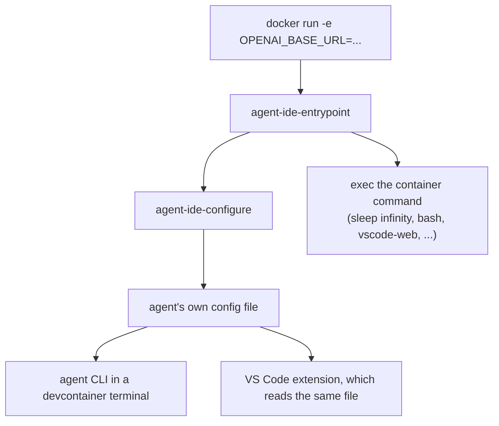

# Agent bundles

Four container images layered on `agent-ide-base:rocky9`, one per coding agent.
Each bundle ships the agent's CLI, the matching VS Code extension (installed
offline from a checksum-pinned VSIX at build time, like the base image) and a
run-time step that points the agent at one OpenAI-compatible endpoint described
by environment variables.

| Bundle | Image | Agent CLI | VS Code extension | Config written at container start |
| --- | --- | --- | --- | --- |
| `opencode/` | `agent-ide-opencode:rocky9` | `opencode` 1.19.3 (release binary, glibc build) | `sst-dev.opencode` 1.0.0 | `~/.config/opencode/opencode.json` |
| `pi/` | `agent-ide-pi:rocky9` | `pi` 1.3.0 (npm, on Node 22.23.3) | `pi0.pi-vscode` 0.0.9 | `~/.pi/agent/models.json`, `~/.pi/agent/settings.json` |
| `goose/` | `agent-ide-goose:rocky9` | `goose` 1.55.0 (release binary) | `block.vscode-goose` 0.2.3 | `~/.config/goose/config.yaml` |
| `vscode-agent/` | `agent-ide-vscode-agent:rocky9` | none - VS Code's built-in agent (`GitHub.copilot-chat` 0.70.0 ships inside the server) | built in | `~/.vscode-server/data/User/chatLanguageModels.json` |

Everything the base image promises still holds: the VS Code Server is baked in
(matching commit `6d62b1d5dace93a33b3a6d3eca1317bd5e15bcb1` = 1.142.0 by
default), extensions come from local VSIX files, and attaching from a desktop
client needs no network.

## How the endpoint configuration works



The agents do not share a config format, so each bundle gets its own renderer
(`agents/<bundle>/configure.sh`), and each renderer is the same three steps:
read the environment, render the agent's native configuration, report what it
wrote. Configuration happens at container start, not only at build time, so
re-pointing a sandbox at another gateway is an environment change plus a
container restart - no rebuild.

Two consequences worth knowing:

* The image *is* built with a default configuration (the public OpenAI endpoint
  and `gpt-4o-mini`) so it is usable out of the box and the build can prove the
  config is consumed. An air-gapped image should always be run with the
  environment set; otherwise the agents will try `api.openai.com` and time out.
* `docker exec` does not re-run the entrypoint. Nothing needs it in the normal
  attach flow (the config is already written by the container's own start), but
  if you start the container with `--entrypoint` overridden, run
  `agent-ide-configure` once inside, or add it as `postStartCommand` in
  `devcontainer.json`.

## Environment contract

Common to all four bundles (values can also be placed in a file, see
`AI_ENV_FILE` below):

| Variable | Default | Meaning |
| --- | --- | --- |
| `OPENAI_BASE_URL` | `https://api.openai.com/v1` | OpenAI-compatible endpoint. May include a path (`/v1`, `/openai/v1`, ...). A full endpoint (`.../v1/chat/completions`) is also accepted and normalized. `OPENAI_API_BASE` works as an alias. |
| `OPENAI_API_KEY` | `agent-ide-placeholder` | Key sent to the endpoint. The placeholder is for gateways that require a key on the wire but do not check it. |
| `OPENAI_MODEL` | `gpt-4o-mini` | Model id served by the endpoint. |
| `OPENAI_MODEL_NAME` | `OPENAI_MODEL` | Display name in pickers/terminals. |
| `OPENAI_MODEL_GROUP` | `Agent Endpoint` | Group label used by the UIs (opencode provider name, pi provider name, VS Code model group). |
| `OPENAI_API_TYPE` | `chat-completions` | `chat-completions`, `responses` or `messages`. |

Per-bundle extras:

| Bundle | Variable | Default | Meaning |
| --- | --- | --- | --- |
| opencode | `OPENCODE_PROVIDER_ID` | `agent-endpoint` | Provider id written into `opencode.json`. |
| opencode | `OPENCODE_CONFIG` | `~/.config/opencode/opencode.json` | Config file to write. |
| pi | `PI_PROVIDER_ID` | `agent-endpoint` | Provider id in `models.json`. |
| pi | `PI_API` | from `OPENAI_API_TYPE` | pi API kind (`openai-completions`, `openai-responses`, ...). |
| pi | `OPENAI_MODEL_CONTEXT_WINDOW` | `128000` | Context window in tokens. |
| pi | `OPENAI_MODEL_MAX_OUTPUT_TOKENS` | `16384` | Max output tokens. |
| pi | `PI_CODING_AGENT_DIR` | `~/.pi/agent` | pi agent directory. |
| goose | `OPENAI_BASE_PATH` | derived, else `v1/chat/completions` | Request path appended to `OPENAI_HOST`. |
| goose | `GOOSE_CONFIG_DIR` | `~/.config/goose` | Config directory. |
| vscode-agent | `OPENAI_MODEL_MAX_INPUT_TOKENS` | `120000` | Model context budget for the BYOK model. |
| vscode-agent | `OPENAI_MODEL_MAX_OUTPUT_TOKENS` | `16000` | Max output tokens for the BYOK model. |
| vscode-agent | `OPENAI_MODEL_TOOL_CALLING` | `true` | Declares tool support (required for agent mode). |
| vscode-agent | `OPENAI_MODEL_VISION` | `false` | Declares image input support. |
| vscode-agent | `VSCODE_USER_DATA_DIR` | `~/.vscode-server/data` | Server user data directory. |

Shared plumbing:

| Variable | Meaning |
| --- | --- |
| `AI_ENV_FILE` | Optional file sourced before defaults (default `/etc/agent-ide/openai.env`; an example ships as `/etc/agent-ide/openai.env.example`). Useful for fleets that mount settings instead of passing `-e` flags; every variable in it is exported. Set to an empty string to disable. On SELinux-enabled hosts, mount it with a label: `-v ./openai.env:/etc/agent-ide/openai.env:ro,z`. |
| `AGENT_IDE_SKIP_CONFIGURE=1` | Entrypoint does not touch the config files (useful when you manage them yourself). |
| `AGENT_IDE_STRICT=1` | Entrypoint fails the container if configuration fails, instead of warning and keeping the baked config. |
| `AGENT_IDE_SANDBOX` | `apply` (default), `require` or `off` - the container-side egress sandbox: install the default-deny rules if possible and warn if not, refuse to start when they cannot be installed, or skip it entirely. See `sandbox/README.md`. |
| `AGENT_IDE_SANDBOX_ALLOW` | Extra destination ranges on top of the sandbox allowlist, e.g. `10.20.0.0/16 192.0.2.7/32`. |

## Build

Build the base image first, then any subset of the bundles (the build context
is the repository root, because each bundle reuses `scripts/install-extensions.sh`):

```sh
podman build -t agent-ide-base:rocky9 .
agents/build.sh                       # all four: agent-ide-<bundle>:rocky9
agents/build.sh opencode goose        # or pick specific ones
agents/build.sh pi -- --build-arg PI_VERSION=1.4.0   # extra build args pass through
```

`agents/build.sh` picks `podman` or `docker` automatically (`--tool` to force).
For a plain build without the script:

```sh
docker build -f agents/opencode/Dockerfile -t agent-ide-opencode:rocky9 .
```

### Build arguments (pins and mirrors)

Every download is version-pinned and checksum-verified, and every URL has an
override for internal mirrors.

| Bundle | Pins | Mirror overrides |
| --- | --- | --- |
| opencode | `OPENCODE_VERSION=1.19.3`, `OPENCODE_ASSET=opencode-linux-x64.tar.gz`, `OPENCODE_SHA256`; extension `OPENCODE_EXT_PUBLISHER/NAME/VERSION/SHA256` = `sst-dev.opencode` 1.0.0 | `OPENCODE_URL`, `OPENCODE_EXT_URL` |
| pi | `NODE_VERSION=22.23.3`, `NODE_ARCH=x64`, `NODE_DIST_SHA256`; `PI_PACKAGE`/`PI_VERSION` = `@earendil-works/pi-coding-agent` 1.3.0; `PI_NPM_REGISTRY`; `PI_TARBALL_URL` + `PI_TARBALL_SHA256` to install pi from a mirrored tarball; extension `PI_EXT_*` = `pi0.pi-vscode` 0.0.9 | `NODE_URL`, `PI_EXT_URL`, `PI_NPM_REGISTRY`, `PI_TARBALL_URL` |
| goose | `GOOSE_VERSION=1.55.0`, `GOOSE_ASSET=goose-x86_64-unknown-linux-gnu.tar.gz`, `GOOSE_SHA256`; extension `GOOSE_EXT_*` = `block.vscode-goose` 0.2.3; `GOOSE_EXT_MIN_CLI_VERSION=1.16.0` cross-checks the pair | `GOOSE_URL`, `GOOSE_EXT_URL` |
| vscode-agent | none beyond `BASE_IMAGE` (the agent comes from the server) | - |

Notes:

* **The base image is the version anchor.** Bumping `VSCODE_COMMIT` in the base
  image and rebuilding the bundles is all that is needed; the bundles do not
  pin a VS Code version themselves.
* **opencode release assets:** this image is glibc-based, so use
  `opencode-linux-x64.tar.gz` (glibc 2.17+, Rocky 9 has 2.34). The `-musl`
  assets need a musl loader (Alpine) and will not start here; the `-baseline`
  assets are the same glibc build without AVX2, for older fleet CPUs.
* **goose release assets:** `goose-x86_64-unknown-linux-gnu.tar.gz` is the
  upstream default for glibc distributions; the `-musl` and `-vulkan` assets
  are drop-in alternatives with their own checksums.
* **arm64:** override the architecture-specific pins - `NODE_ARCH=arm64` plus
  the matching `NODE_DIST_SHA256`, the `GOOSE_ASSET`, and the opencode asset -
  and build the base image with `--build-arg VSCODE_ARCH=arm64`.
* **Extension checksums** are of the VSIX as `curl --compressed` writes it (the
  marketplace serves the file gzip-encoded). To re-pin after an upgrade:
  `curl -fsSL --compressed <vspackage-url> | sha256sum`.

## Run

Every bundle is a dev container: start it, then attach with **Dev Containers:
Attach to Running Container...**, exactly like the base image.

```sh
podman run -d --name opencode-devbox \
  --cap-add=NET_ADMIN -e AGENT_IDE_SANDBOX=require \
  -e OPENAI_BASE_URL=http://gateway.internal:8080/v1 \
  -e OPENAI_API_KEY=sk-internal \
  -e OPENAI_MODEL=qwen3-coder \
  agent-ide-opencode:rocky9 sleep infinity
```

`--cap-add=NET_ADMIN` lets the entrypoint install the container-side egress
sandbox: public IP space is denied; the LAN (NFS, the gateway) stays reachable.
With `AGENT_IDE_SANDBOX=require` the container refuses to start if that fails, so
an agent can never run unfiltered by accident. Without the capability the
container still starts, but its logs carry a loud warning that egress is not
filtered (`AGENT_IDE_SANDBOX=apply`, the default). See `sandbox/README.md` for
the full policy, the host-side half and what it does not cover.

The same three variables work for all four bundles. The browser UI is available
in every bundle too:

```sh
podman run --rm -p 8000:8000 --cap-add=NET_ADMIN -e AGENT_IDE_SANDBOX=require \
  -e OPENAI_BASE_URL=http://gateway.internal:8080/v1 -e OPENAI_MODEL=qwen3-coder \
  agent-ide-pi:rocky9 vscode-web
```

> **Hosts that hold CUI, ITAR or proprietary data:** run these containers on a
> network whose egress is denied by default, or the agents' own defaults
> (`api.openai.com` from the image, telemetry from any tool they shell out to)
> become accidental data paths. `sandbox/README.md` covers the policy, the
> rootless-networking pitfall that silently bypasses it, and the script that
> proves the result.

For a project devcontainer, start from `examples/devcontainer-agent.json`
(`containerEnv` carries the endpoint; `postStartCommand` re-runs the renderer if
you override the entrypoint) and adjust the image name.

### What "working" looks like

```sh
# opencode
podman exec opencode-devbox bash -lc 'opencode models agent-endpoint'
podman exec opencode-devbox bash -lc 'opencode run "say hi"'

# pi
podman exec pi-devbox bash -lc 'pi --offline --list-models agent-endpoint; pi -p "say hi"'

# goose
podman exec goose-devbox bash -lc 'goose info -v | grep -E "GOOSE_PROVIDER|OPENAI_HOST"'

# VS Code built-in agent
podman exec vscode-agent-devbox bash -lc 'jq . ~/.vscode-server/data/User/chatLanguageModels.json'
```

In the VS Code window: the opencode/pi/goose extensions appear in the activity
bar and launch the CLI in a terminal; in the vscode-agent bundle, open Chat and
select the model from the `Agent Endpoint` group in the model picker (the
**Chat: Manage Language Models** command shows the same list).

Each bundle's *build* runs these checks too: the configure script is rendered
with throwaway values and the agent has to report them back
(`opencode models`, `pi --offline --list-models`, `goose info -v`, `jq` on the
rendered JSON). A bundle whose configuration stopped working fails to build.

## Air-gapped transfer

The images are self-contained: CLI binaries, the VS Code Server, the extensions
and the endpoint configuration are all inside, and nothing is fetched at
runtime. So the transfer is just an image archive:

```sh
podman save --format docker-archive -o agent-ide-opencode.tar agent-ide-opencode:rocky9
# inside the isolated network
podman load -i agent-ide-opencode.tar
```

`testing/make-bundle.sh --image agent-ide-opencode:rocky9` reuses the existing
bundle machinery (client rpm, Dev Containers VSIX, offline rpm dependencies)
with a derived image if you want the full VM acceptance test for a bundle; note
that its output filenames are still base-image oriented.

Bundle-specific network notes:

* **opencode** declares `"autoupdate": false`. The OpenAI-compatible provider is implemented inside the binary, so a custom provider needs nothing from the npm registry at runtime (checked with the network disabled: with an unreachable endpoint, `opencode run` reports a connection error and never an install error).
* **pi** sets `PI_OFFLINE=1` (no pi.dev catalog refresh, no version check) and
  `PI_TELEMETRY=0`. Clear them with `-e PI_OFFLINE= -e PI_TELEMETRY=` if the
  container can reach the network and you want catalog updates.
* **goose** sets `GOOSE_DISABLE_KEYRING=1` so secrets use
  `~/.config/goose/secrets.yaml` (there is no desktop keyring in a container)
  and disables telemetry. Remember that goose ignores API keys in
  `config.yaml`: provide `OPENAI_API_KEY` in the environment (the entrypoint
  keeps it there), or store it once with `goose configure`.
* **vscode-agent** needs no GitHub account and no Copilot plan for BYOK chat -
  that is upstream's documented behavior. Features that are served by GitHub
  Copilot itself (inline completions, semantic search, embeddings) stay
  unavailable offline. The desktop client must be new enough to know the
  `customendpoint` provider (1.1xx); older clients simply ignore the file.

## Updating the pins

1. Check upstream for the new CLI/extension version and update the `ARG`s.
2. For GitHub release assets, the release API publishes the digest:
   `curl -s https://api.github.com/repos/<owner>/<repo>/releases/latest | jq -r '.assets[] | .name + " " + .digest'`
3. For Node.js, read `https://nodejs.org/dist/v<NODE_VERSION>/SHASUMS256.txt`.
4. For extensions, re-download with `--compressed` and take `sha256sum`.
5. Rebuild (`agents/build.sh <bundle>`); the build fails loudly on a checksum
   mismatch or on an agent that did not pick up its configuration.

## Troubleshooting

* *Agents point at `api.openai.com`*: the environment was not set when the
  container started. Check `podman logs <container>` for the
  `[agent-ide-configure]` lines, then set the variables and restart, or run
  `podman exec <container> agent-ide-configure`.
* *A command cannot reach the internet*: that is the egress sandbox working as
  intended (public IP space denied, LAN allowed). Look at it with
  `podman exec <container> agent-ide-sandbox check`, at the container's start
  logs (`podman logs <container> | grep agent-ide-sandbox`) and at the denials
  the host logs as `agent-egress-drop:`. To allow a specific server, add it via
  `AGENT_IDE_SANDBOX_ALLOW` or the `allowed4` / `allowed6` sets in
  `sandbox/nftables/egress-container.nft` - prefer that over
  `AGENT_IDE_SANDBOX=off`, which turns the sandbox off entirely.
* *The container refuses to start with "the container egress sandbox could not be applied"*:
  `AGENT_IDE_SANDBOX=require` is set and the rules could not be installed -
  usually because `--cap-add=NET_ADMIN` is missing, or because
  `--security-opt no-new-privileges` blocks the `sudo` the applier needs to
  become root.
* *The VS Code extension cannot find the CLI*: the bundles pin
  `pi-vscode.path` / `goose.binaryPath` in machine settings, and opencode's
  extension uses the terminal's PATH. If you build your own derived image,
  keep the CLI in `/usr/local/bin`.
* *pi reports "No API key"*: `~/.pi/agent/models.json` holds the key it was
  rendered with; re-run `agent-ide-configure` with `OPENAI_API_KEY` set.
* *goose reports "No api key passed in"*: the key was placed in
  `config.yaml`; goose ignores it there by design. Use `OPENAI_API_KEY` or
  `goose configure`.
* *The BYOK model does not appear in the picker*: reload the window; and make
  sure the model declares `toolCalling: true` (`OPENAI_MODEL_TOOL_CALLING`) -
  models without tool support are hidden from agent mode.
